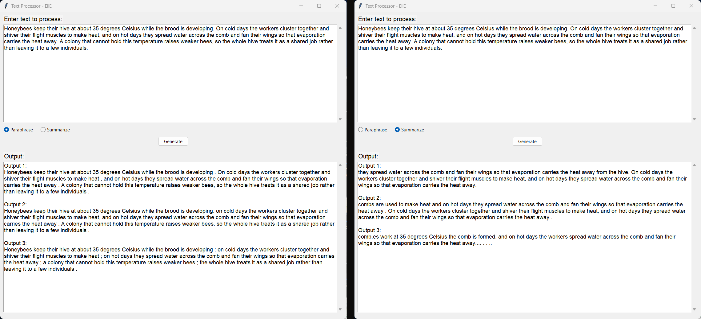
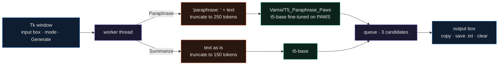

<div align="center">

# Text Processor

**A Tkinter desktop app that paraphrases or summarizes a paragraph with two Hugging Face T5 models and shows three candidates for each.**




</div>

Text Processor is an experiment and isn't finished: the app runs, but summaries come out garbled because the code leaves out T5's task prefix, and paraphrases mostly copy the input (see Limitations).
This is a small desktop front end for two off-the-shelf T5 checkpoints that runs locally. You paste a paragraph,
pick Paraphrase or Summarize, and get three candidates you can select and copy or save to a `.txt` file.
Generation runs on a worker thread, so the window stays responsive while the model works. The screenshots above are
from a real run of `app.py`, unchanged, driven by `scripts/capture_screenshots.py`.

---

## How it works



Both models load when the app starts, on the GPU if PyTorch can see one and on the CPU otherwise. The Generate
button starts a thread that tokenizes the input, calls `generate()`, and puts the decoded strings on a queue; the Tk
loop polls that queue every 100 ms and fills the output box. The two modes use different decoding settings:

| | Paraphrase | Summarize |
|---|---|---|
| model | `Vamsi/T5_Paraphrase_Paws` | `t5-base` |
| input | `"paraphrase: " + text`, max 250 tokens | text with no task prefix, max 150 tokens |
| decoding | 10 beams with sampling, temperature 0.7, top-k 50, top-p 0.85, repetition penalty 1.1 | sampling, temperature 0.7, top-k 50, top-p 0.85 |
| output length | up to 250 tokens | 60 to 150 tokens |
| candidates | 3 | 3 |

## A sample run

I gave it a 78-word paragraph about how honeybees hold their hive at 35 °C (107 T5 tokens) and ran each mode. With a
fixed seed, three runs produced identical text and pixel-identical screenshots (the image above). PyTorch was the CPU
build with 4 threads on a machine busy with other jobs: in the quietest run paraphrasing took 24 s and summarizing
11 s, and under heavier load either mode took up to 409 s.

Paraphrase returned the input almost word for word. Two of the three candidates contain exactly the same 78 words
in the same order and differ only in punctuation (a colon in place of a full stop, spaces before commas). The third
joins the sentences with semicolons and drops two words. The PAWS checkpoint was trained on sentence pairs, and with
10-beam search over a whole paragraph it settles on copying.

Summarize didn't summarize. All three candidates start mid-sentence ("they spread water across the comb..."),
repeat the same clause two or three times, and the third falls apart ("comb.es work at 35 degrees Celsius the comb is
formed..."). The cause is the input: `summarize_text()` passes the paragraph to `t5-base` without the `summarize: `
task prefix that T5 was trained with. Outside the app, with the same model and sampling settings, adding the prefix
gave this:

> beekeepers keep their hive at 35 degrees Celsius while the brood is developing . a colony that cannot hold this
> temperature raises weaker bees . the whole hive treats it as a shared job rather than leaving it to a few individuals .

Apart from "beekeepers", that is a usable summary.

## Quickstart

```bash
git clone https://github.com/EllE961/TextProcessor-EllE.git
cd TextProcessor-EllE
python -m venv .venv
.venv\Scripts\activate             # Windows; use source .venv/bin/activate elsewhere
pip install -r requirements.txt
python app.py                      # first start downloads about 1.8 GB of model weights
```

`pip install -r requirements.txt` pulls the CPU build of PyTorch 2.4.1 from PyPI. For an NVIDIA GPU, install torch
from the PyTorch index first and the app will use it automatically. To regenerate the screenshots on Windows:
`pip install pillow`, then `python scripts/capture_screenshots.py`.

## Repository map

```text
app.py                          the whole app: model loading, generation, Tk layout, copy/save/clear
requirements.txt                pinned versions (torch 2.4.1, transformers 4.45.1, sentencepiece 0.2.0, ...)
app.spec                        PyInstaller spec for a windowed app.exe
scripts/capture_screenshots.py  runs app.py with a scripted mainloop and saves the window captures
docs/assets/                    screenshots used in this README
```

## Limitations

- The summarize path is missing T5's `summarize: ` prefix (see above). It also truncates its input to 150 tokens, about 110 words of English, so anything longer is cut before the model sees it, and `min_length=60` forces long outputs even for short input.
- The paraphrase model works on single sentences. Given a paragraph it mostly hands the text back.
- At the default 900 × 800 window the layout asks for 893 px of height, so the row with Copy Selected Text, Save Output and Clear is squeezed to nothing. The buttons appear once the window is made taller; the screenshots are at the default size, which is why they're missing there.
- Both models (892 MB each) load before the window opens, and the first start has to download them.
- Errors are reported with `messagebox` from the worker thread, which Tkinter doesn't support.
- The v1.0.0 release has no `app.exe` attached, so there is no prebuilt download. `app.spec` builds one with PyInstaller (`pyinstaller app.spec`); I haven't tested that build.

## License

MIT, see [LICENSE](LICENSE).
